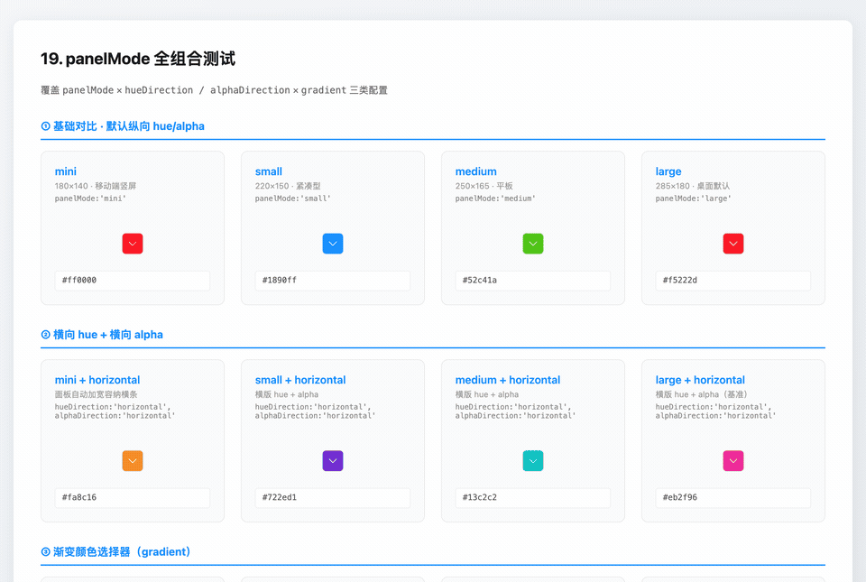

# ew-color-picker


**English | [中文](./README.zh-CN.md)**

Event-driven, plugin-based modern color picker. The core only keeps color state and an event bus — all UI is assembled from plugins that can be composed, replaced, or extended.

**[Playground — 24 editable examples →](https://eveningwater.github.io/ew-color-picker/playground.html)** · **[Live demo](https://eveningwater.github.io/ew-color-picker/examples/demo)** · **[Documentation](https://eveningwater.github.io/ew-color-picker/)**



```bash
pnpm add @ew-color-picker/ew-color-picker @ew-color-picker/style
```

Latest release: `2.0.13` · [Changelog](https://eveningwater.github.io/ew-color-picker/guide/changelog)

- Documentation: https://eveningwater.github.io/ew-color-picker/
- China mirror (Alibaba Cloud ESA): https://ew-color-picker.eveningwater.com/
- Playground (edit and run every example): https://eveningwater.github.io/ew-color-picker/playground.html
- Live demo: https://eveningwater.github.io/ew-color-picker/examples/demo
- Changelog: https://eveningwater.github.io/ew-color-picker/guide/changelog
- My website: https://www.eveningwater.com
- AI index: [llms.txt](https://eveningwater.github.io/ew-color-picker/llms.txt) · [llms-full.txt](https://eveningwater.github.io/ew-color-picker/llms-full.txt)

## Features

- **Plugin architecture** — Box, Panel, Hue, Alpha, Input, InputNumber, Button, Predefine, ColorMode, Eyedropper and CopyColor are independent plugins
- **Panel size presets** — `panelMode: 'mini' | 'small' | 'medium' | 'large'` scales the panel and every control inside it, so mobile layouts fit without custom CSS
- **Gradient editor** — multi-stop gradients with linear / radial / conic types, angle and repeating support
- **Framework agnostic** — plain DOM core, mountable from Vue, React, Svelte or any other framework
- **Official wrappers** — `@ew-color-picker/vue` and `@ew-color-picker/react` are thin, typed and optional
- **Event driven** — `change` / `sure` / `clear` / `toggle` / `mode-change` / `options-update` / `destroy`
- **Multiple color spaces** — Hex, RGB and HSL input modes with alpha support
- **Fully typed** — every package is written in TypeScript and ships declarations
- **Instance isolation** — each instance owns its event bus, DOM and plugin instances
- **Tree-shakeable** — every plugin is its own package; import only the ones you register

## Comparison

| | ew-color-picker | vue-color | react-colorful | iro.js |
| --- | --- | --- | --- | --- |
| Framework | Vanilla TS + official Vue 3 / React wrappers | Vue 2 | React | Vanilla JS |
| Architecture | 15 composable plugins | Monolithic components | Monolithic components | Monolithic |
| Gradient editor | Built in (multi-stop, linear / radial / conic) | No | No | No |
| Eyedropper | Built in (native EyeDropper API) | No | No | No |
| Mobile panel size presets | `panelMode` (4 sizes) | No | No | No |
| Text / number color inputs | Built in | Picker-specific | No | No |
| TypeScript | Yes | No | Yes | Yes |
| Runtime dependencies | None | tinycolor2 | None | None |

Full breakdown: [Comparison](https://eveningwater.github.io/ew-color-picker/guide/comparison).

## Bundle size

`@ew-color-picker/ew-color-picker` registers every plugin, so it is the worst case:

| Asset | Minified | Gzipped |
| --- | --- | --- |
| `dist/index.min.js` (all 15 plugins) | 141 KB | **34.1 KB** |
| `@ew-color-picker/style/dist/index.css` | 37 KB | 5.7 KB |

Import individual plugin packages instead to ship only what you register.

## Packages

| Package | Responsibility |
| --- | --- |
| `@ew-color-picker/core` | Color state, event bus, mount points, plugin registry |
| `@ew-color-picker/utils` | DOM / color / animation helpers, `EventEmitter`, `Console` plugin |
| `@ew-color-picker/style` | CSS (`index.css` + `input-number.css`) |
| `@ew-color-picker/ew-color-picker` | All-in-one bundle: registers all plugins, exports the core |
| `@ew-color-picker/box` | Trigger swatch |
| `@ew-color-picker/panel` | Saturation/value panel |
| `@ew-color-picker/hue` | Hue slider |
| `@ew-color-picker/alpha` | Alpha slider |
| `@ew-color-picker/input` | Text color input |
| `@ew-color-picker/input-number` | Numeric input component and plugin |
| `@ew-color-picker/button` | Clear / Sure buttons |
| `@ew-color-picker/predefine` | Predefined swatches |
| `@ew-color-picker/color-mode` | Hex / RGB / HSL mode switching |
| `@ew-color-picker/gradient` | Multi-stop gradient editor (linear / radial / conic) |
| `@ew-color-picker/select` | Themed select with truncated-text tooltip |
| `@ew-color-picker/checkbox` | Themed checkbox used by the gradient editor |
| `@ew-color-picker/tooltip` | Standalone tooltip utility (also usable in your own components) |
| `@ew-color-picker/eyedropper` | Screen color picker via the native EyeDropper API (Chromium) |
| `@ew-color-picker/copy-color` | Copy the current color to the clipboard |
| `@ew-color-picker/vue` | Vue 3 wrapper (`v-model`, typed props, exposed instance API) |
| `@ew-color-picker/react` | React wrapper (`forwardRef`, typed props, exposed instance API) |

## Install

```bash
pnpm add @ew-color-picker/ew-color-picker @ew-color-picker/style
# or the v1-compatible entry package (forwards to the two packages above)
pnpm add ew-color-picker
```

```ts
import ewColorPicker from '@ew-color-picker/ew-color-picker'
import '@ew-color-picker/style/dist/index.css'
import '@ew-color-picker/style/dist/input-number.css'

const picker = new ewColorPicker({
  el: '#colorPicker',
  defaultColor: '#6366f1',
})

picker.on('change', (color) => console.log('color:', color))
```

> Both stylesheets are required: `index.css` styles the picker, `input-number.css` styles the RGB/HSL numeric inputs.

### Per-package imports

```ts
import ewColorPicker from '@ew-color-picker/core'
import Box from '@ew-color-picker/box'
import Panel from '@ew-color-picker/panel'
import Hue from '@ew-color-picker/hue'
import Input from '@ew-color-picker/input'
import Button from '@ew-color-picker/button'

ewColorPicker.use(Box).use(Panel).use(Hue).use(Input).use(Button)

new ewColorPicker({ el: '#colorPicker' })
```

### Vue 3 / React

```bash
pnpm add @ew-color-picker/vue    # or @ew-color-picker/react
```

```vue
<script setup lang="ts">
import { ref } from 'vue'
import { EwColorPicker } from '@ew-color-picker/vue'
import '@ew-color-picker/style/dist/index.css'
import '@ew-color-picker/style/dist/input-number.css'

const color = ref('#6366f1')
</script>

<template>
  <EwColorPicker v-model="color" :options="{ panelMode: 'small' }" />
</template>
```

```tsx
import { useState } from 'react'
import { EwColorPicker } from '@ew-color-picker/react'
import '@ew-color-picker/style/dist/index.css'
import '@ew-color-picker/style/dist/input-number.css'

export function ColorField() {
  const [color, setColor] = useState('#6366f1')
  return (
    <EwColorPicker value={color} onChange={setColor} options={{ panelMode: 'small' }} />
  )
}
```

The wrappers only own the host element and the instance lifecycle; options and events are forwarded to the core picker. See [Framework Integration](https://eveningwater.github.io/ew-color-picker/guide/framework-integration).

### UMD

```html
<link rel="stylesheet" href="https://unpkg.com/@ew-color-picker/style/dist/index.css" />
<link rel="stylesheet" href="https://unpkg.com/@ew-color-picker/style/dist/input-number.css" />

<div id="colorPicker"></div>
<script src="https://unpkg.com/@ew-color-picker/ew-color-picker/dist/index.min.js"></script>
<script>
  new ewColorPicker({ el: '#colorPicker', defaultColor: '#ff0000' })
</script>
```

## Usage

```ts
const picker = new ewColorPicker({
  el: '#colorPicker',
  defaultColor: 'rgba(99, 102, 241, 0.8)',
  size: 'large',
  hueDirection: 'horizontal',
  alphaDirection: 'horizontal',
  predefineColor: ['#ef4444', '#22c55e', '#3b82f6', { color: '#0f172a', disabled: true }],
  clearText: 'Reset',
  sureText: 'Apply',
  autoPanelPosition: true,
  panelPlacement: 'bottom-start',
  togglePickerAnimation: 'height',
  pickerAnimationTime: 250,
  changeColor: (color) => console.log('callback:', color),
})

picker.on('sure', (color, instance) => console.log('sure:', color, instance.getColor()))
picker.on('clear', () => console.log('cleared'))
picker.on('mode-change', (mode) => console.log('mode:', mode))
```

## Options

| Option | Type | Default | Description |
| --- | --- | --- | --- |
| `el` | `string \| HTMLElement` | `document.body` | Mount container; auto-mounts when provided |
| `disabled` | `boolean` | `false` | Disable all interaction |
| `defaultColor` | `string` | `''` | Initial and clear-restore color |
| `size` | `string \| number \| object` | `'normal'` | Trigger box size: `mini`/`small`/`normal`/`medium`/`large`, number, or `{ width, height }` |
| `panelMode` | `'mini' \| 'small' \| 'medium' \| 'large'` | `'large'` | Panel size preset; scales the panel and all inner controls. Use `'mini'` on mobile |
| `predefineColor` | `(string \| { color, disabled? })[]` | `[]` | Swatches; empty renders nothing |
| `isClickOutside` | `boolean` | `true` | Close on outside click |
| `hueDirection` | `'vertical' \| 'horizontal'` | `'vertical'` | Hue orientation |
| `alphaDirection` | `'vertical' \| 'horizontal'` | `'vertical'` | Alpha orientation |
| `autoPanelPosition` | `boolean` | `false` | Auto placement (requires Box) |
| `panelPlacement` | `string` | `'bottom'` | 12 placement values |
| `clearText` / `sureText` | `string` | `'清空'` / `'确定'` | Button labels |
| `togglePickerAnimation` | `string` | `'default'` | `default` / `height` / `opacity` |
| `pickerAnimationTime` | `number` | `200` | Animation duration (≤10000ms) |
| `hasBox` / `hasPanel` / `hasInput` | `boolean` | `true` | Toggle plugins |
| `hasClear` / `hasSure` | `boolean` | `true` | Toggle buttons |
| `hue` / `alpha` | `boolean` | `true` | Toggle sliders |
| `showButton` / `showColorMode` / `showInputNumber` | `boolean` | `true` | Toggle bottom area |
| `showEyedropper` | `boolean` | `true` | Toggle the screen picker (Chromium only) |
| `showCopyColor` | `boolean` | `true` | Toggle the copy-to-clipboard button |
| `eyedropperText` | `string` | `undefined` | Eyedropper label / tooltip; also rendered as visible text |
| `copyColorText` / `copiedText` | `string` | `'复制颜色到剪贴板'` / `'已复制'` | Copy button tooltip / success hint |
| `defaultMode` | `'hex' \| 'rgb' \| 'hsl'` | `'rgb'` with Alpha, else `'hex'` | Initial mode |
| `readonly` | `boolean` | `false` | Block box clicks |
| `className` / `style` | `string \| object` | `''` | Box class / inline style |
| `changeColor` | `(color) => void` | - | Color change callback |
| `sure` | `(color, picker) => void` | - | Sure callback |
| `clear` | `(picker) => void` | - | Clear callback |
| `togglePicker` | `(isOpen) => void` | - | Panel toggle callback |
| `onEyedropperPick` | `(color) => void` | - | Eyedropper pick callback |
| `onCopyColor` | `(color) => void` | - | Copy-to-clipboard success callback |

Full reference: [Options](https://eveningwater.github.io/ew-color-picker/api/options).

## Methods

| Method | Description |
| --- | --- |
| `setColor(color)` | The only recommended color entry; emits `change` |
| `getColor()` | Current color |
| `getHsvaColor()` / `setHsvaColor(hsva)` | Read/write HSVA (setter emits nothing) |
| `showPanel()` / `hidePanel()` | Open/close the panel |
| `openPicker()` / `closePicker()` | Aliases of the above |
| `getOptions()` / `updateOptions(options)` | Read/write options; latter emits `options-update` |
| `mount(el?)` / `getContainer()` / `getMountPoint(name)` | Mounting and container access |
| `on` / `once` / `off` / `trigger` / `emit` | Event API |
| `destroy()` / `getDestroyedStatus()` | Cleanup and status |

Full reference: [Methods](https://eveningwater.github.io/ew-color-picker/api/methods).

## Events

| Event | Payload | Description |
| --- | --- | --- |
| `change` | `(color)` | Color changed |
| `toggle` | `(isOpen)` | Panel toggled |
| `sure` | `(color, picker)` | Sure clicked |
| `clear` | `()` | Clear clicked |
| `options-update` | `(options)` | Options updated |
| `mode-change` | `(mode)` | `hex` / `rgb` / `hsl` |
| `destroy` | `()` | Instance destroyed |

Returning `true` from a listener stops the remaining listeners.

## Custom plugins

```ts
import ewColorPicker from '@ew-color-picker/core'
import { ApplyOrder } from '@ew-color-picker/utils'

export default class CustomPlugin {
  static pluginName = 'CustomPlugin'
  static applyOrder = ApplyOrder.Post

  constructor(public ewColorPicker: ewColorPicker) {
    // render into a mount point and subscribe to events
  }

  destroy() {
    // release DOM and listeners
  }
}
```

```ts
ewColorPicker.use(CustomPlugin)
```

See the [plugin guide](https://eveningwater.github.io/ew-color-picker/guide/plugin-dev).

## Development

```bash
pnpm install         # install dependencies
pnpm run build:all   # build all packages and styles
pnpm run dev:preview # live example server
pnpm run test:run    # run the full test suite
pnpm run docs:dev    # start the documentation site
pnpm run docs:build  # build the documentation
```

## Documentation

- English: https://eveningwater.github.io/ew-color-picker/
- Chinese: https://eveningwater.github.io/ew-color-picker/zh/
- China mirror (Alibaba Cloud ESA): https://ew-color-picker.eveningwater.com/
- Examples: https://eveningwater.github.io/ew-color-picker/examples/
- Demo: https://eveningwater.github.io/ew-color-picker/examples/demo

## Contributing

Issues and pull requests are welcome.

## License

MIT License

---

**Author**: eveningwater  
**Repository**: https://github.com/eveningwater/ew-color-picker
