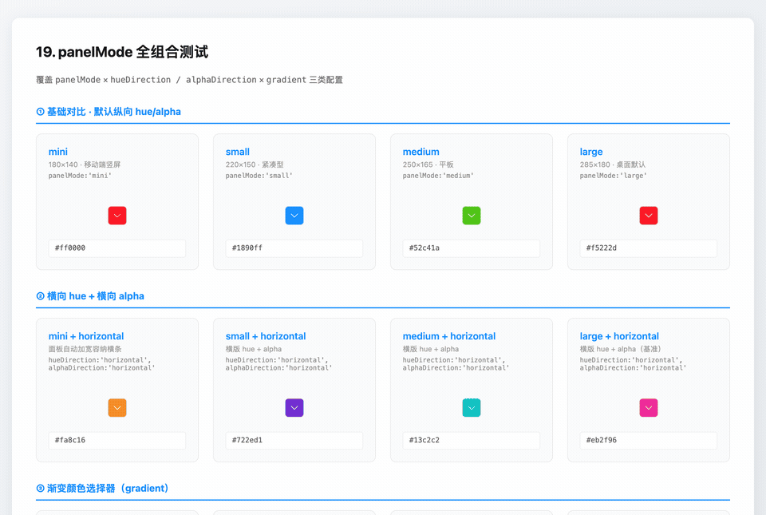

# ew-color-picker


**[English](./README.md) | 中文**

事件驱动 + 插件化的现代颜色选择器。核心只维护颜色状态与事件，界面全部由插件组装，可按需组合、替换与扩展。

**[立即体验在线演示 →](https://eveningwater.github.io/ew-color-picker/zh/examples/demo)** · **[中文文档](https://eveningwater.github.io/ew-color-picker/zh/)**



```bash
pnpm add @ew-color-picker/ew-color-picker @ew-color-picker/style
```

最新版本：`2.0.10` · [更新日志](https://eveningwater.github.io/ew-color-picker/zh/guide/changelog)

- 官网文档：https://eveningwater.github.io/ew-color-picker/zh/
- 国内访问（阿里云 ESA）：https://ew-color-picker.eveningwater.com/zh/
- 在线演示：https://eveningwater.github.io/ew-color-picker/zh/examples/demo
- 更新日志：https://eveningwater.github.io/ew-color-picker/zh/guide/changelog
- 个人站点：https://www.eveningwater.com
- AI 文档索引：[llms.txt](https://eveningwater.github.io/ew-color-picker/llms.txt) · [llms-full.txt](https://eveningwater.github.io/ew-color-picker/llms-full.txt)

## 特性

- **插件架构**：Box、Panel、Hue、Alpha、Input、InputNumber、Button、Predefine、ColorMode、Eyedropper、CopyColor 全部是独立插件
- **面板尺寸档位**：`panelMode: 'mini' | 'small' | 'medium' | 'large'`，面板及内部控件整体缩放，移动端无需额外写 CSS
- **渐变编辑器**：多停靠点渐变，支持线性 / 径向 / 圆锥，可调角度与重复
- **框架无关**：原生 DOM 实现，可在 Vue、React、Svelte 等任意框架中挂载
- **官方封装包**：`@ew-color-picker/vue` 与 `@ew-color-picker/react`，薄封装、带类型、按需安装
- **事件驱动**：`change` / `sure` / `clear` / `toggle` / `mode-change` / `options-update` / `destroy`
- **多颜色模式**：Hex、RGB、HSL 输入切换，支持透明度
- **完整类型**：全部包使用 TypeScript 编写并输出声明文件
- **多实例隔离**：每个实例拥有独立事件总线、DOM 与插件实例
- **按需加载**：每个插件都是独立包，可只引入所需插件

## 对比

| | ew-color-picker | vue-color | react-colorful | iro.js |
| --- | --- | --- | --- | --- |
| 框架支持 | 原生 TS + 官方 Vue 3 / React 封装包 | Vue 2 | React | 原生 JS |
| 架构 | 15 个可组合插件 | 单体组件 | 单体组件 | 单体 |
| 渐变编辑器 | 内置（多停靠点，线性 / 径向 / 圆锥） | 无 | 无 | 无 |
| 吸管取色 | 内置（原生 EyeDropper API） | 无 | 无 | 无 |
| 移动端面板档位 | `panelMode`（4 档） | 无 | 无 | 无 |
| 文本 / 数字颜色输入 | 内置 | 视具体组件而定 | 无 | 无 |
| TypeScript | 是 | 否 | 是 | 是 |
| 运行时依赖 | 无 | tinycolor2 | 无 | 无 |

完整对比见 [对比文档](https://eveningwater.github.io/ew-color-picker/zh/guide/comparison)。

## 体积

`@ew-color-picker/ew-color-picker` 会注册全部插件，属于最大体积场景：

| 资源 | 压缩前 | Gzip |
| --- | --- | --- |
| `dist/index.min.js`（全部 15 个插件） | 141 KB | **34.1 KB** |
| `@ew-color-picker/style/dist/index.css` | 37 KB | 5.7 KB |

按需引入单个插件包可以显著减小体积，只有注册的插件才会被打包。

## 包结构

| 包 | 职责 |
| --- | --- |
| `@ew-color-picker/core` | 颜色状态、事件总线、挂载点、插件注册 |
| `@ew-color-picker/utils` | DOM / 颜色 / 动画工具、`EventEmitter`、`Console` 插件 |
| `@ew-color-picker/style` | 样式产物（`index.css` + `input-number.css`） |
| `@ew-color-picker/ew-color-picker` | 聚合包：注册全部插件并导出核心 |
| `@ew-color-picker/box` | 触发器色块 |
| `@ew-color-picker/panel` | 饱和度 / 明度面板 |
| `@ew-color-picker/hue` | 色相滑块 |
| `@ew-color-picker/alpha` | 透明度滑块 |
| `@ew-color-picker/input` | 文本颜色输入框 |
| `@ew-color-picker/input-number` | 数字输入组件与插件 |
| `@ew-color-picker/button` | 清空 / 确定按钮 |
| `@ew-color-picker/predefine` | 预定义颜色 |
| `@ew-color-picker/color-mode` | Hex / RGB / HSL 模式切换 |
| `@ew-color-picker/gradient` | 多停靠点渐变编辑器（线性 / 径向 / 圆锥） |
| `@ew-color-picker/select` | 主题化下拉选择，截断时自动展示 tooltip |
| `@ew-color-picker/checkbox` | 主题化复选框，供渐变编辑器使用 |
| `@ew-color-picker/tooltip` | 独立悬浮提示工具包（也可用于自己的组件） |
| `@ew-color-picker/eyedropper` | 屏幕吸管取色（原生 EyeDropper API，Chromium） |
| `@ew-color-picker/copy-color` | 复制当前颜色到剪贴板 |
| `@ew-color-picker/vue` | Vue 3 封装组件（`v-model`、类型化 props、暴露实例 API） |
| `@ew-color-picker/react` | React 封装组件（`forwardRef`、类型化 props、暴露实例 API） |

## 安装

```bash
pnpm add @ew-color-picker/ew-color-picker @ew-color-picker/style
# 或使用兼容 v1 的入口包（内部指向上面两个包）
pnpm add ew-color-picker
```

```ts
import ewColorPicker from '@ew-color-picker/ew-color-picker'
import '@ew-color-picker/style/dist/index.css'
import '@ew-color-picker/style/dist/input-number.css'

const picker = new ewColorPicker({
  el: '#colorPicker',
  defaultColor: '#6366f1',
})

picker.on('change', (color) => console.log('颜色改变：', color))
```

> 两个样式文件都需要引入：`index.css` 负责选择器，`input-number.css` 负责 RGB/HSL 数字输入框。

### 按需引入

```ts
import ewColorPicker from '@ew-color-picker/core'
import Box from '@ew-color-picker/box'
import Panel from '@ew-color-picker/panel'
import Hue from '@ew-color-picker/hue'
import Input from '@ew-color-picker/input'
import Button from '@ew-color-picker/button'

ewColorPicker.use(Box).use(Panel).use(Hue).use(Input).use(Button)

new ewColorPicker({ el: '#colorPicker' })
```

### Vue 3 / React

```bash
pnpm add @ew-color-picker/vue    # 或 @ew-color-picker/react
```

```vue
<script setup lang="ts">
import { ref } from 'vue'
import { EwColorPicker } from '@ew-color-picker/vue'
import '@ew-color-picker/style/dist/index.css'
import '@ew-color-picker/style/dist/input-number.css'

const color = ref('#6366f1')
</script>

<template>
  <EwColorPicker v-model="color" :options="{ panelMode: 'small' }" />
</template>
```

```tsx
import { useState } from 'react'
import { EwColorPicker } from '@ew-color-picker/react'
import '@ew-color-picker/style/dist/index.css'
import '@ew-color-picker/style/dist/input-number.css'

export function ColorField() {
  const [color, setColor] = useState('#6366f1')
  return (
    <EwColorPicker value={color} onChange={setColor} options={{ panelMode: 'small' }} />
  )
}
```

封装包只负责宿主元素与实例生命周期，配置与事件全部转发给核心选择器，详见[框架集成](https://eveningwater.github.io/ew-color-picker/zh/guide/framework-integration)。

### UMD

```html
<link rel="stylesheet" href="https://unpkg.com/@ew-color-picker/style/dist/index.css" />
<link rel="stylesheet" href="https://unpkg.com/@ew-color-picker/style/dist/input-number.css" />

<div id="colorPicker"></div>
<script src="https://unpkg.com/@ew-color-picker/ew-color-picker/dist/index.min.js"></script>
<script>
  new ewColorPicker({ el: '#colorPicker', defaultColor: '#ff0000' })
</script>
```

## 使用示例

```ts
const picker = new ewColorPicker({
  el: '#colorPicker',
  defaultColor: 'rgba(99, 102, 241, 0.8)',
  size: 'large',
  hueDirection: 'horizontal',
  alphaDirection: 'horizontal',
  predefineColor: ['#ef4444', '#22c55e', '#3b82f6', { color: '#0f172a', disabled: true }],
  clearText: '重置',
  sureText: '应用',
  autoPanelPosition: true,
  panelPlacement: 'bottom-start',
  togglePickerAnimation: 'height',
  pickerAnimationTime: 250,
  changeColor: (color) => console.log('回调：', color),
})

picker.on('sure', (color, instance) => console.log('确定：', color, instance.getColor()))
picker.on('clear', () => console.log('已清空'))
picker.on('mode-change', (mode) => console.log('模式：', mode))
```

## 配置项

| 选项 | 类型 | 默认值 | 说明 |
| --- | --- | --- | --- |
| `el` | `string \| HTMLElement` | `document.body` | 挂载容器，提供后自动挂载 |
| `disabled` | `boolean` | `false` | 禁用全部交互 |
| `defaultColor` | `string` | `''` | 初始颜色，也是清空后的还原色 |
| `size` | `string \| number \| object` | `'normal'` | 颜色盒（触发器）尺寸：`mini`/`small`/`normal`/`medium`/`large`、数字、`{ width, height }` |
| `panelMode` | `'mini' \| 'small' \| 'medium' \| 'large'` | `'large'` | 面板尺寸档位，面板及内部控件整体缩放；移动端建议 `'mini'` |
| `predefineColor` | `(string \| { color, disabled? })[]` | `[]` | 预定义颜色，为空则不渲染 |
| `isClickOutside` | `boolean` | `true` | 点击外部关闭面板 |
| `hueDirection` | `'vertical' \| 'horizontal'` | `'vertical'` | 色相滑块方向 |
| `alphaDirection` | `'vertical' \| 'horizontal'` | `'vertical'` | 透明度滑块方向 |
| `autoPanelPosition` | `boolean` | `false` | 面板自动定位（需 Box） |
| `panelPlacement` | `string` | `'bottom'` | 12 个方位值，见文档 |
| `clearText` / `sureText` | `string` | `'清空'` / `'确定'` | 按钮文案 |
| `togglePickerAnimation` | `string` | `'default'` | `default` / `height` / `opacity` |
| `pickerAnimationTime` | `number` | `200` | 动画时长（≤10000ms） |
| `hasBox` / `hasPanel` / `hasInput` | `boolean` | `true` | 控制对应插件 |
| `hasClear` / `hasSure` | `boolean` | `true` | 控制按钮 |
| `hue` / `alpha` | `boolean` | `true` | 控制滑块 |
| `showButton` / `showColorMode` / `showInputNumber` | `boolean` | `true` | 控制底部区域 |
| `showEyedropper` | `boolean` | `true` | 控制吸管按钮（仅 Chromium） |
| `showCopyColor` | `boolean` | `true` | 控制复制颜色按钮 |
| `eyedropperText` | `string` | `undefined` | 吸管按钮文案 / 提示，设置后可见 |
| `copyColorText` / `copiedText` | `string` | `'复制颜色到剪贴板'` / `'已复制'` | 复制按钮提示 / 复制成功提示 |
| `defaultMode` | `'hex' \| 'rgb' \| 'hsl'` | 有 Alpha 时 `rgb`，否则 `hex` | 初始模式 |
| `readonly` | `boolean` | `false` | 只读：阻止点击色块 |
| `className` / `style` | `string \| object` | `''` | 色块额外类名 / 内联样式 |
| `changeColor` | `(color) => void` | - | 颜色改变回调 |
| `sure` | `(color, picker) => void` | - | 确定回调 |
| `clear` | `(picker) => void` | - | 清空回调 |
| `togglePicker` | `(isOpen) => void` | - | 面板开合回调 |
| `onEyedropperPick` | `(color) => void` | - | 吸管取色回调 |
| `onCopyColor` | `(color) => void` | - | 复制颜色成功回调 |

完整说明见[配置项文档](https://eveningwater.github.io/ew-color-picker/zh/api/options)。

## 实例方法

| 方法 | 说明 |
| --- | --- |
| `setColor(color)` | 唯一推荐的改色入口，触发 `change` |
| `getColor()` | 获取当前颜色 |
| `getHsvaColor()` / `setHsvaColor(hsva)` | 读写 HSVA（后者不触发事件） |
| `showPanel()` / `hidePanel()` | 开合面板 |
| `openPicker()` / `closePicker()` | 上面两个的别名 |
| `getOptions()` / `updateOptions(options)` | 读写配置，后者触发 `options-update` |
| `mount(el?)` / `getContainer()` / `getMountPoint(name)` | 挂载与容器访问 |
| `on` / `once` / `off` / `trigger` / `emit` | 事件 API |
| `destroy()` / `getDestroyedStatus()` | 销毁与状态查询 |

完整签名见[实例方法文档](https://eveningwater.github.io/ew-color-picker/zh/api/methods)。

## 事件

| 事件 | 参数 | 说明 |
| --- | --- | --- |
| `change` | `(color)` | 颜色改变 |
| `toggle` | `(isOpen)` | 面板开合 |
| `sure` | `(color, picker)` | 点击确定 |
| `clear` | `()` | 点击清空 |
| `options-update` | `(options)` | 配置更新 |
| `mode-change` | `(mode)` | `hex` / `rgb` / `hsl` |
| `destroy` | `()` | 实例销毁 |

监听函数返回 `true` 可中断后续监听。

## 自定义插件

```ts
import ewColorPicker from '@ew-color-picker/core'
import { ApplyOrder } from '@ew-color-picker/utils'

export default class CustomPlugin {
  static pluginName = 'CustomPlugin'
  static applyOrder = ApplyOrder.Post

  constructor(public ewColorPicker: ewColorPicker) {
    // 渲染到挂载点并订阅事件
  }

  destroy() {
    // 释放 DOM 与事件
  }
}
```

```ts
ewColorPicker.use(CustomPlugin)
```

详见[插件开发指南](https://eveningwater.github.io/ew-color-picker/zh/guide/plugin-dev)。

## 本地开发

```bash
pnpm install         # 安装依赖
pnpm run build:all   # 构建全部包与样式
pnpm run dev:preview # 示例热更新服务
pnpm run test:run    # 全量测试
pnpm run docs:dev    # 启动文档站点
pnpm run docs:build  # 构建文档
```

## 文档

- 中文：https://eveningwater.github.io/ew-color-picker/zh/
- English：https://eveningwater.github.io/ew-color-picker/
- 国内访问（阿里云 ESA）：https://ew-color-picker.eveningwater.com/zh/
- 示例：https://eveningwater.github.io/ew-color-picker/zh/examples/
- 演示：https://eveningwater.github.io/ew-color-picker/zh/examples/demo

## 贡献

欢迎提交 Issue 与 Pull Request。

## 许可证

MIT License

---

**作者**：eveningwater  
**仓库**：https://github.com/eveningwater/ew-color-picker
